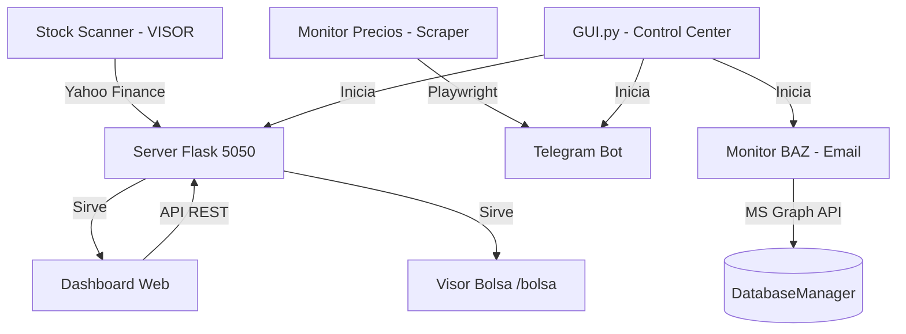

# 🧪 Radiografía Completa: Ecosistema Asistente Financiero
**Versión:** 4.0 (Unified & Optimized)  
**Fecha:** 15 de Mayo de 2026  
**Estado:** Integrado y Estabilizado

---

## 1. Arquitectura del Sistema (Vista de Pájaro)
El sistema opera como un ecosistema unificado donde múltiples servicios independientes convergen en una sola interfaz de control y un único servidor web.

### Diagrama de Flujo de Datos

---

## 2. Inventario de Componentes y Responsabilidades

### A. Núcleo (Root)
1. **`gui.py`**: El "Cerebro" visual. 
   - Gestiona el ciclo de vida de los hilos.
   - Centraliza el inicio del Bot de Telegram, el Servidor Flask y los monitores de fondo.
   - Maneja el túnel público (Ngrok/Cloudflare) para acceso móvil.
2. **`start.bat`**: Punto de entrada único para el usuario.
3. **`.env`**: Almacén de secretos (Tokens, API Keys de Gemini, Credenciales de Email).

### B. Directorio `src/` (Lógica de Negocio)
1. **`server.py`**: Servidor unificado (Puerto 5050).
   - Sirve el Dashboard principal.
   - **NUEVO:** Integra las APIs del Stock Scanner (VISOR).
   - **NUEVO:** Gestiona el Auto-Escaneo de bolsa en segundo plano.
2. **`bot.py`**: Interfaz de Telegram.
   - Procesa comandos (`/start`, `/visual`, `/bolsa`, `/transactions`).
   - Envía alertas de gastos y de precios bajos.
3. **`monitor.py`**: El vigilante incansable.
   - **Hilo 1**: Llama a `email_reader.py` para procesar gastos de Banco Azteca.
   - **Hilo 2**: Scraper de precios (Liverpool/Palacio) para productos de interés (Drones, iPhones, MacBooks).
4. **`database.py`**: Gestor de persistencia (SQLite).
   - Centraliza todas las consultas de gastos, categorías y estadísticas.
5. **`dashboard.py`**: Motor de plantillas HTML.
   - Genera el Dashboard interactivo con estética *Glassmorphism*.
   - Integra la "Calculadora de Crisis" y "Salud Financiera".
6. **`email_reader.py`**: Integración con Microsoft Graph API.
   - Lee correos, usa Regex y Gemini AI para extraer montos y comercios de notificaciones bancarias.
7. **`config.py`**: Validaciones y configuración estática del sistema.

### C. Herramientas Integradas (`tools/`)
1. **`NOTIFICADOR_BOT` (VISOR de Bolsa)**:
   - **`stock_scanner.py`**: Motor de análisis técnico (RSI, MACD, Bollinger).
   - **`portfolio_analyzer.py`**: Analiza listas de tickers personalizadas.
   - **`index.html`**: Interfaz de inversiones integrada ahora en el servidor 5050.

---

## 3. Mecanismos de Automatización Críticos

### 1. Ingesta de Gastos "Cero Clics"
- **Entrada**: Correo de "Notificación de Gasto" de BAZ.
- **Proceso**: El `EmailReader` detecta el correo -> Gemini AI confirma el comercio si el Regex falla -> Se inserta en la BD como `unconfirmed`.
- **Salida**: Notificación inmediata a Telegram con botón de revisión.

### 2. Monitor de Oportunidades (Drones/Tech)
- **Proceso**: Cada hora, el monitor revisa los precios en tiempo real.
- **Inteligencia**: Filtra "basura" (fundas, cables) y se enfoca en hardware. Si el precio está un 5% por debajo del promedio histórico, dispara una alerta "Hot".

### 3. Auto-Escaneo de Bolsa
- **Proceso**: Hilo residente en `server.py` que despierta cada hora en horario de mercado (NYSE).
- **Ventaja**: La información siempre está lista en el Visor sin que el usuario tenga que esperar al escaneo manual.

---

## 4. Dependencias Clave
- **Backend**: `Flask`, `Flask-CORS`, `yfinance`, `pandas`, `msal`, `google-generativeai`.
- **Frontend**: `Tailwind CSS`, `Chart.js`, `LiquidGL` (Glassmorphism), `FontAwesome`.
- **Scraping**: `Playwright` (Chromium headless), `BeautifulSoup4`.
- **Notificaciones**: `python-telegram-bot`, `httpx`.

---

## 5. Áreas de Observación (Puntos para Revisar)
1. **Consistencia de Categorías**: El mapeo entre `email_reader.py` y `DatabaseManager` debe mantenerse sincronizado para evitar "OTRO".
2. **Gestión de Sesión MSAL**: El archivo `.token_cache.json` es crítico para que el lector de correos no pida login constantemente.
3. **Escalabilidad de Stock Scanner**: Actualmente corre en un hilo dentro del server; si se añaden demasiados tickers, podría impactar la respuesta del dashboard.
4. **Resiliencia del Túnel**: Depende de la estabilidad de la conexión local para mantener el link público activo.

---
**Generado por:** Antigravity AI
**Estado del Código:** Integrado, Unificado y Operativo bajo el nombre "Asistente Financiero".
